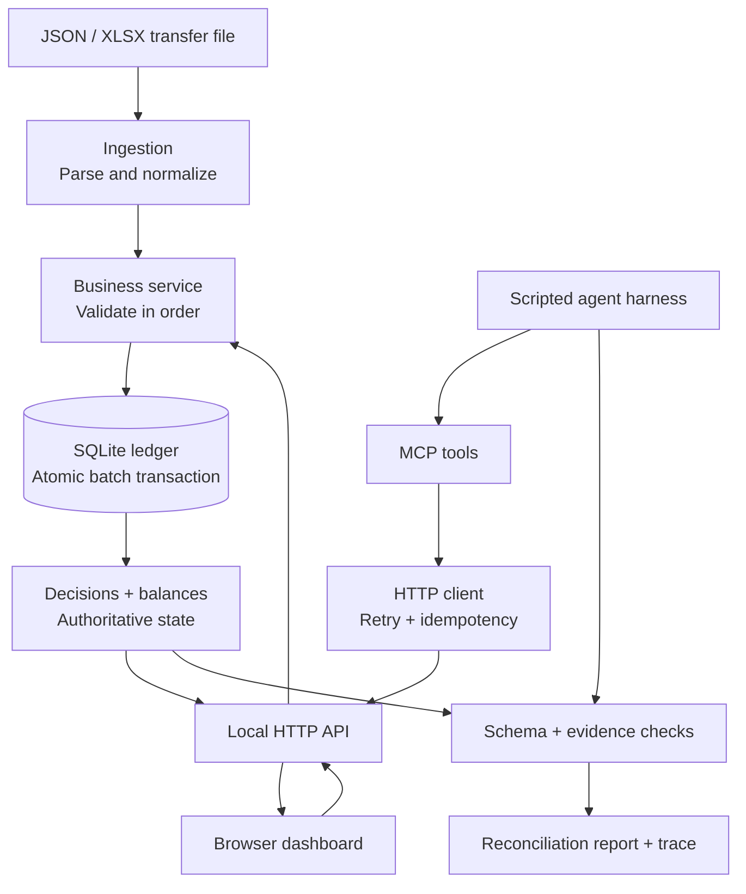

<div align="center">

# Flowline
### Transfer operations, made transparent.

**A hands-on workspace for processing financial transfers, understanding every decision, and proving the ledger stays consistent.**

[**Get started**](#get-started) · [**Explore the workflow**](#the-experience) · [**How it works**](#under-the-hood) · [**Tests & requirements**](#engineering-proof)

[](https://github.com/Or04/flowline-transfer-agent/actions/workflows/tests.yml)


</div>

---

## Meet Flowline

A transfer file shouldn't be a black box.

**Flowline turns a batch of transfers into a clear, inspectable workflow.** Operators can process a sample batch, see which payments were accepted or rejected, inspect live account balances, and deliberately trigger a database failure to verify that no partial transfer slips through.

The interface is intentionally simple. **The deterministic financial engine—not the browser or an AI model—makes every money decision.**

| **Operate** | **Understand** | **Trust** |
| :--- | :--- | :--- |
| Process or reset the sample batch | See each transfer's outcome and rejection reason | Verify atomic writes, idempotency and money conservation |
| Explore account balances | Review the reconciliation summary | Test failures without changing financial rules |

## Get started

**Requirements:** Python 3.11+. No cloud account or LLM API key required.

```bash
git clone https://github.com/Or04/flowline-transfer-agent.git
cd flowline-transfer-agent
python -m pip install -e '.[test]'
python -m transfer_flow.dashboard
```

Open **http://127.0.0.1:8787**.

> **First 60 seconds:** Select **Reset demo** → **Process batch** → inspect the decisions and balances → **Reset demo** → **Simulate rollback** → **Process batch** to see an atomic failure. Reset once more to return to a clean demo.

The dashboard runs locally on `127.0.0.1` and uses the real SQLite-backed transfer engine. Its default database is in memory, so data resets when the server restarts.

## The experience

### One workspace. Four questions answered.

| Area | What you learn |
| :--- | :--- |
| **Overview** | How many transfers succeeded, failed, or were duplicates? |
| **Transfer decisions** | What happened to each row—and why? |
| **Accounts** | What are the current balances after processing? |
| **Reconciliation** | Does the total money before and after still match? |

### A sample run

The included dataset contains **5 accounts** and **12 transfer rows**.

| Accepted | Rejected | Duplicate | Money conserved |
| :---: | :---: | :---: | :---: |
| **4** | **7** | **1** | **Yes** |

**ILS 17,300.00 before → ILS 17,300.00 after.**

Rejected rows carry specific reason codes, including insufficient funds, invalid amount, unknown account, unsupported currency and transfer limit violations. A repeated transfer reference is identified rather than executed again.

### Try the failure scenario

**Simulate rollback** injects a failure during ledger writes. The batch fails, and SQLite rolls back its changes: **no partial balance updates**. This is the core guarantee the demo is designed to make visible.

## Under the hood



**The boundaries matter:**

- **Ingestion** reads JSON and XLSX. It does not decide whether a transfer is valid.
- **Business service** applies ordered validation rules. The first failing rule explains the rejection.
- **Ledger** persists amounts as integer agorot and commits all accepted writes in a single transaction—or rolls everything back on a write failure.
- **HTTP + MCP** expose controlled operations to clients and agents.
- **Agent harness** orchestrates tools and builds a report. It cannot override the ledger's decisions.

### Reliability by design

| Guarantee | How Flowline handles it |
| :--- | :--- |
| **Atomicity** | A failed write rolls back the entire batch's ledger changes |
| **Idempotency** | A content-derived key prevents duplicate processing on retries |
| **Ambiguous failures** | A lost HTTP `500` response can be retried safely with the same key |
| **Precision** | Account balances are stored in integer agorot, not floating-point values |
| **Reconciliation** | Opening and closing money totals are checked |
| **AI safety** | A malicious instruction in a transfer `memo` is treated as data; final reports are validated against authoritative results |

## The agent, explained simply

Flowline includes an **MCP server** with three tools:

```text
submit_batch(filePath)
       ↓
get_batch_status(batchId)
       ↓
get_ledger_summary()
       ↓
Validate report against ledger evidence
```

The default agent uses a **scripted LLM substitute**, making its tool calls repeatable and testable without external services. It records a trace and validates structured output. This is a real tool-execution harness, **not** a claim that a live generative model is connected.

The MCP server also restricts which local files an agent may submit. The supplied sample deliberately contains a prompt-injection attempt in a transfer memo; it cannot change the business decisions.

## Engineering proof

The implementation includes a local HTTP mock, the three required processing layers, an SQLite ledger, an MCP server, an agent harness, structured reports, and automated tests.

| What is checked | Evidence |
| :--- | :--- |
| Business validation | Transfer decisions and rejection codes |
| Ledger correctness | SQLite records, conservation, and rollback |
| Network resilience | Retry and duplicate-submission scenarios |
| Agent safety | Structured-report validation and tampering tests |
| Integration | HTTP dashboard endpoints and real MCP subprocess |
| Bonus | XLSX ingestion and GitHub Actions CI |

**Verified in GitHub Actions: 12 passed, 0 failed, 0 skipped**, including the MCP subprocess test using MCP 1.x.

Run the suite yourself:

```bash
pytest -q
```

For the separate mock API and agent flow, run these in different terminals:

```bash
python -m transfer_flow.mock
```

```bash
python -m transfer_flow.agent transfers.json
```

Example artifacts: [report](example-report.json) · [agent trace](example-trace.json) · [source dataset](transfers.json).

<details>
<summary><strong>Assignment checklist and API reference</strong></summary>

| Requirement | Implementation |
| :--- | :--- |
| HTTP mock | `POST /__reset`, `POST /__faults`, `POST /batches`; `GET /batches/:id`, `GET /accounts/:id`, `GET /ledger/summary` |
| Ingestion | JSON and optional XLSX parser |
| Business | Ordered validation; first failure wins |
| Persistence | SQLite transactional ledger |
| Atomic failure | Deterministic `failOnWrite` fault injection |
| Retry and idempotency | Stable key derived from batch content |
| MCP tools | `submit_batch`, `get_batch_status`, `get_ledger_summary` |
| Agent harness | Scripted planner, tool loop, step budget, trace, error handling |
| Report | Schema and authoritative-result verification |
| Security test | Prompt injection embedded in sample memo |
| Bonus | Browser UI, XLSX, CI |

</details>

<details>
<summary><strong>Implementation notes and production boundaries</strong></summary>

- The mock processes batches synchronously despite returning HTTP `202`; a production service would use a durable queue and workers.
- The dashboard is a **local demonstration**, not a hosted production banking application. It has no authentication. Reset and fault-injection endpoints must not be exposed publicly.
- Before real financial use: add authentication, authorization, explicit approval for money-moving operations, audit trails, observability, and operational recovery.
- Real-model evaluations would run separately from deterministic CI, with protected credentials and comparisons against ledger evidence.

</details>

---

<div align="center">

**Flowline makes the invisible parts of transfer processing visible.**

*Process with confidence. Inspect every decision. Trust the ledger.*

</div>
