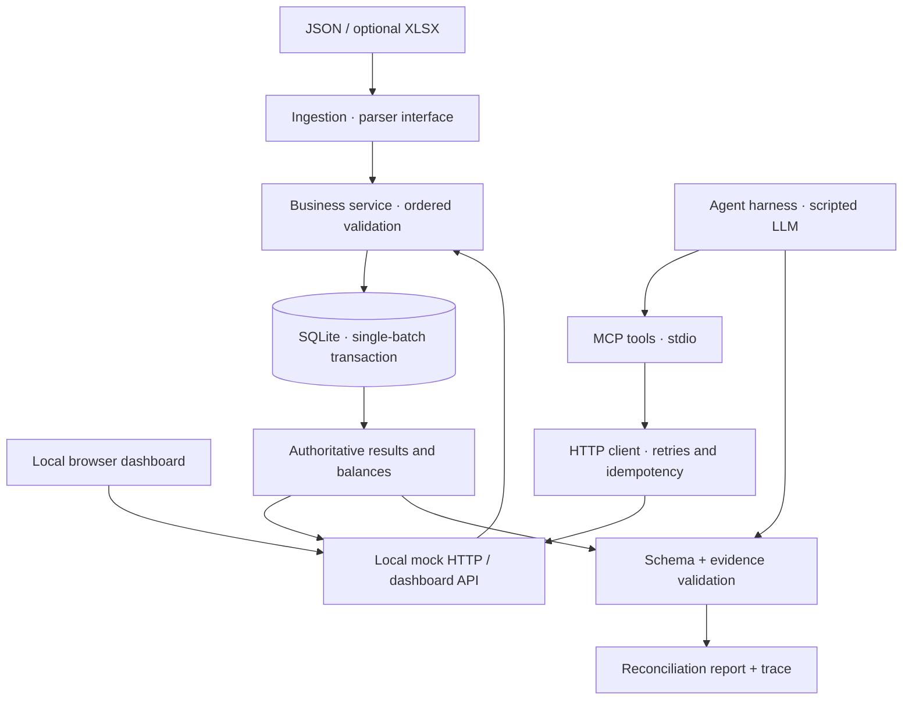

# Flowline

[](https://github.com/Or04/flowline-transfer-agent/actions/workflows/tests.yml)

**An interactive transfer operations workspace with a deterministic ledger and an MCP-powered agent harness.**

Process a batch, inspect every decision, simulate a write failure, and verify that money is conserved. The browser is a thin operator interface; the financial engine remains the source of truth.

## Run it

Python 3.11+ required. From the project root:

```bash
python -m pip install -e '.[test]'
python -m transfer_flow.dashboard
```

Open **http://127.0.0.1:8787**. Choose **Reset demo**, then **Process batch**. Use **Simulate rollback** to see an atomic failure and unchanged balances.

```bash
pytest -q
python -m transfer_flow.mock
python -m transfer_flow.agent transfers.json
```

The agent uses a scripted LLM by default: no API key or external LLM is required. The official MCP Python SDK must be installed for the subprocess transport. The dashboard itself uses only the Python standard library. The checked-in sample XLSX can be regenerated with `python -m tools.generate_sample_xlsx`.

## Product tour

| Screen area | Purpose |
| --- | --- |
| Summary | Opening and closing money, accepted count, conservation check |
| Reconciliation | Accepted / rejected / duplicate breakdown |
| Accounts | Live SQLite balances |
| Decisions | Row-level results and first failing business rule |
| Controls | Reset, submit (idempotent), inject an atomic write failure |

## Architecture



**Boundaries:** Ingestion parses formats, not rules. Business validates in specified order and decides each row. Persistence commits all accepted ledger writes in one SQLite transaction or rolls them all back. The MCP agent invokes tools and reports results, but cannot change financial decisions.

## Requirements covered

| Assignment requirement | Implementation / proof |
| --- | --- |
| Remote HTTP mock | `POST /__reset`, `/batches`, `/__faults`; `GET /batches/:id`, `/accounts/:id`, `/ledger/summary` |
| Ordered validation | Eight rules; first failure determines the rejection code |
| Atomicity | SQLite transaction, deterministic `failOnWrite`, full rollback |
| Idempotency | Content-derived key; lost `500` response retried without duplicate batch |
| Source data | 5 opening accounts, 12 transfers; 4 accepted, 7 rejected, 1 duplicate |
| Conservation | Opening and current total: **ILS 17,300.00** |
| MCP | `submit_batch`, `get_batch_status`, `get_ledger_summary` |
| Write guardrail | MCP file-path allowlist |
| Agent harness | Scripted planner, tool loop, step budget, errors, trace |
| Structured output | Exact schema and authoritative-result comparison |
| Prompt injection | Malicious `memo` in `T-012` cannot override ledger decisions |
| Bonus | XLSX parser; browser demo |

## Testing

`pytest -q` covers row decisions and DB records, duplicate submissions, full rollback, ambiguous HTTP 500 retries, fake-agent success and failure, report tampering, XLSX equivalence, and the live dashboard endpoints. The real MCP subprocess integration test runs in CI with the SDK installed; an offline environment without that dependency skips it. **A skipped integration test must not be treated as a pass.**

Verified on GitHub Actions with the official MCP 1.x SDK: **12 passed, 0 failed, 0 skipped**. The real stdio MCP subprocess is included in this result.

## Decisions and trade-offs

- **Integer agorot**, not floating-point arithmetic, for persisted balances.
- **Synchronous processing behind HTTP 202** keeps the exercise deterministic; production would use a durable queue and worker.
- **Local-only operator dashboard** has no authentication and is not intended for public deployment. Administrative reset and fault endpoints must be protected or removed in production.
- **Agent output is untrusted.** Memo text is data, and every report is checked against the ledger's authoritative response.

**With another day:** add authentication and explicit write approval, queue-backed asynchronous processing, operational metrics, real-LLM evals, and browser E2E tests.

**Real-LLM eval / CI:** run 3–5 fixed goals against a real model and grade the final structured reports against authoritative ledger data. In CI, always run the scripted tests offline; run real-model evals separately with protected credentials and deterministic acceptance criteria.
